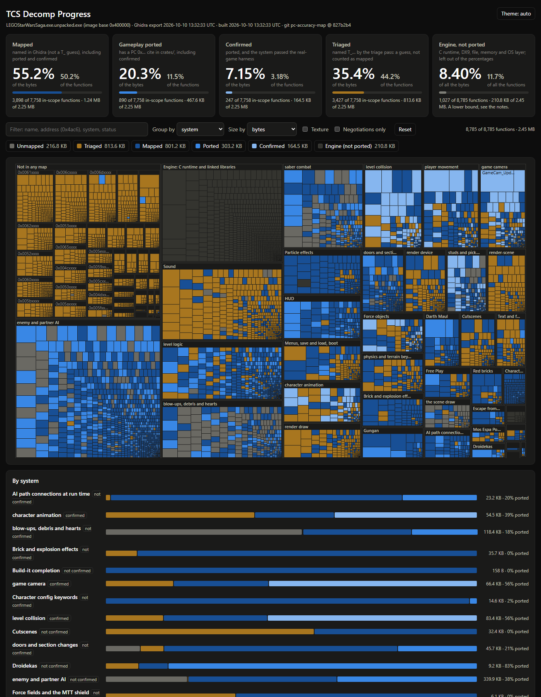

# TCS decomp progress

Progress of a private rewrite of LEGO Star Wars: The Complete Saga (PC) in Rust and Bevy: how many functions of the PC executable are mapped, ported and confirmed. This repo holds numbers only (counts, sizes, percentages, function addresses and statuses). It contains no game files, no decompiled code and no game data.

Live page: https://drket.github.io/tcs-progress/

Ported (in-scope code, by bytes): 20.3%

Generated 2026-10-10T13:32:33Z from private repo commit `827b2b4` by `tools/progress/publish.py`.
